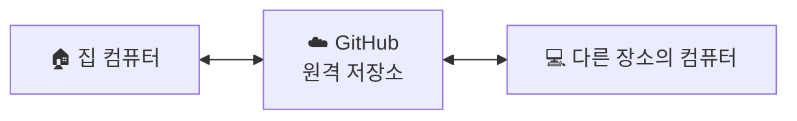

#
##
###
####
#####

-

1.
2.

|

[이모지] Window + .

# 로컬(Local)과 원격(Remote) 저장소

## 1. 개념 정리

| 구분 | 설명 |
|---|---|
| **로컬(Local)** | 내 컴퓨터에 있는 저장소 |
| **원격(Remote)** | GitHub에 있는 저장소 |

## 2. 구조 도식화

## 3. 활용 예시

GitHub에 로그인하면 다른 장소에서도 저장한 파일에 접근할 수 있다.

## 4. 핵심 요약

- **로컬** = 내 컴퓨터에 저장
- **원격** = GitHub에 저장
- GitHub를 이용하면 파일을 메일로 따로 옮기지 않아도 다른 장소에서 쉽게 확인하고 관리할 수 있다.

2026-10-21
구글 심볼
구글 폰트

codex에서 필요한 이미지와 같은 자료를 찾아달라고 요청

id>class

[수업 내용 정리]

1. id가 class보다 더 강력한 명령이다.

2. css에서 id 지정 방법은 # (class 지정방법은 .)

3. 웹페이지에서 필요한 이미지 또는 수치와 같은 필요한 정보가 있다면, codex에서 playwright MCP 도구를 사용해서 조작할 수 있는 브라우저를 열어 달라고 한뒤, 그 브라우저에서 사이트를 검색해야 codex와 연결이 된다.

*** /permission은 all allow 선택

웹페이지의 이미지를 다운 받기 전에는, codex에게 현재 열려 있는 페이지를 확인해보라고 명령을 내려야 한다. 

4.'구글 심볼' 사이트에서 찾은 심볼을 코드로 넣을때는, 심볼 클릭시 나타나는 span으로 시작하는 코드를 copy해서 붙여넣으면 된다.

5.웹표준 시멘틱 구조
